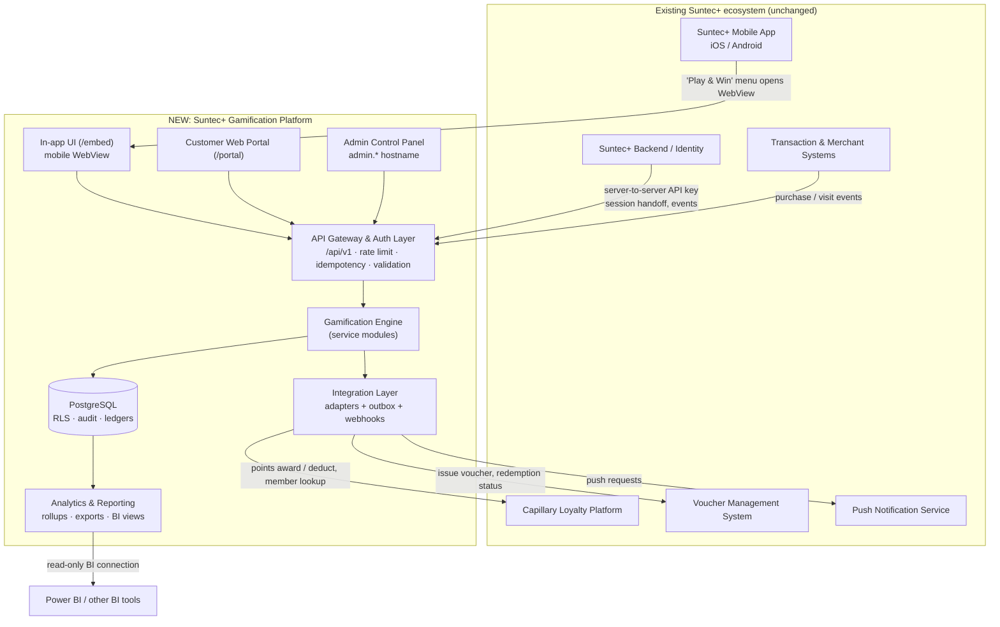
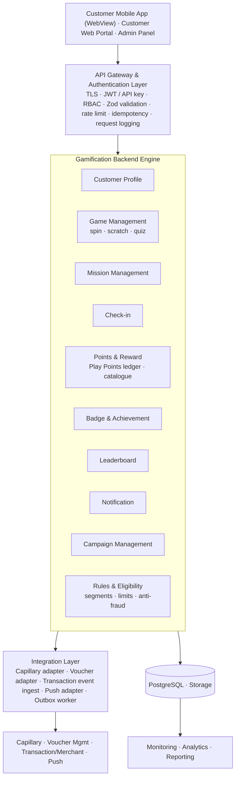
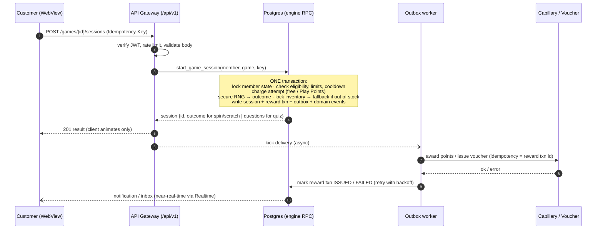

# 1. Proposed Solution Architecture

## 1.1 Context: what we build and what we only connect to

**Isolation guarantees**

- **No database sharing:** the platform never reads from or writes to any Suntec+ or Capillary database. All communication goes through APIs.
- **The app degrades gracefully:** if the platform fails, the native app is unaffected. Only the "Play & Win" screen shows a friendly error state.
- **No coupling on the hot path:** game plays never wait on Capillary. Rewards are recorded in our database, then delivered to Capillary or the voucher system asynchronously through the outbox, with retries.
- **Upstream protection:** circuit breakers and timeouts (4 s by default) on every upstream call, so a slow Capillary does not exhaust our resources.

## 1.2 Logical architecture (as in brief §8)

**How the modules are implemented.** Each service module is a separate **bounded context** in code and data. It has its own folder in `packages/core`, its own SQL schema section and RPC functions, and its own API routes. All modules deploy together as a *modular monolith*, which is the right size for this volume: one deployment, one database transaction boundary, and no network hops between modules. The boundaries are explicit, so any module (for example Leaderboard or Notification) can later be split out into its own service without rewriting the others. Modules talk to each other through a **domain event bus** (the `domain_events` table, written inside the same transaction). For example, `checkin.completed` updates mission progress, badges and leaderboard scores.

## 1.3 Request flow: playing a game (anti-tamper)

- **Spin & Win and Scratch & Win:** the outcome is fixed when the session starts. The scratch card's reveal step is purely visual.
- **Quiz & Trivia:** the session start returns the questions *without answers*. The submit step is validated on the server: answers are checked against a server-side key and the time limit is enforced from server timestamps.

## 1.4 Identity and session architecture

| Channel | How the customer is identified |
|---|---|
| Mobile app (WebView) | The Suntec+ backend calls `POST /integrations/sessions` with the member ID and receives a **single-use code (60 s TTL, hashed at rest)**. The WebView opens `/embed?code=…`, and we exchange the code for a short-lived gamification session (secure, HttpOnly, SameSite cookie, with a bearer fallback). The customer never logs in twice. |
| Web portal | Preferred: **Suntec+ SSO (OIDC)**, if the Suntec+ identity platform supports it. Fallback: email OTP, with the account linked to a Suntec+ member through Capillary lookup (email or mobile, plus card number verification). |
| Admin panel | Staff accounts in Supabase Auth with MFA (TOTP) required, RBAC roles, a 30-minute idle timeout, and optional SSO with the Suntec+ corporate IdP (Azure AD / SAML) on the Supabase Team plan. Served only on the `admin.` hostname, with an optional IP allowlist. |
| Server-to-server | Per-client **API keys** (hashed, scoped and rotatable). Optional HMAC request signing (`X-Signature`, with a timestamp to prevent replay) for event ingest. |

## 1.5 Security and compliance (brief §10)

| Requirement | Control |
|---|---|
| Encryption in transit and at rest | TLS 1.2+ everywhere (Vercel and Supabase). Postgres and Storage are encrypted at rest (AES-256). Secrets live only in environment variables. |
| Authentication and tokens | Short-lived JWTs with refresh rotation. Handoff codes are single-use and hashed. API keys are stored only as SHA-256 hashes, are scoped and can be rotated. |
| Authorization | Row Level Security on every table. RBAC checked both in the API and in SQL (`has_permission()`). The service-role key is used only on the server. |
| Input validation and injection | Zod schemas on every endpoint. Parameterised RPCs only (no string-built SQL). Output encoding through React, a strict CSP, `X-Frame-Options` and CSRF protection on cookie sessions. |
| Rate limiting and duplicate requests | Per-member, per-IP and per-API-client limits. An `Idempotency-Key` is required on every write that moves value. Unique constraints back up the business rules (one check-in per member per day, one mission completion per period, and so on). |
| Anti-fraud | Results are decided on the server only, and reward values never come from the client. Velocity checks per member, device and IP. Many members on one device is flagged. QR codes are signed and rotating. Quiz timing is validated. Members can be auto-flagged and blocked, and a fraud signal dashboard is provided. |
| Request tampering | Signed QR payloads, HMAC on integration events, and server timestamps (client clocks are ignored). |
| Audit | `audit_log` is append-only and records who, what, before/after, IP and time for every admin action and every manual reward. It is retained for 7 years (configurable). |
| PDPA | Data minimisation: we store only the member ID, display name, email or mobile and tier. Personal data is masked on leaderboards, with a member opt-out. Purpose limitation is enforced through role-based access. Access and erasure requests use an admin "export / anonymise member" tool. Data is hosted in Singapore. Breach response is covered in the runbook. |
| Retention | Raw events kept 13 months, then aggregated. Game sessions kept 24 months. Reward transactions and audit records kept 7 years. Inactive member profiles are anonymised after 24 months. All periods are configurable and run as scheduled jobs. |
| Backup and DR | Supabase daily backups plus Point-in-Time Recovery in PROD. Quarterly restore drills. Infrastructure as code (migrations in git) lets us rebuild an environment from scratch. |
| Monitoring and alerts | Structured JSON logs with a request ID, Sentry for errors, uptime checks, and alerts on 5xx rate, reward failure rate, outbox backlog, inventory depletion and fraud-signal spikes. |

## 1.6 Environments (DEV, SIT, UAT and PROD)

| Env | Supabase project | Vercel | Data | Loyalty adapter |
|---|---|---|---|---|
| DEV | `suntec-gami-dev` | Preview deployments per branch | Seed and demo data | Mock |
| SIT | `suntec-gami-sit` | `sit.` domain | Synthetic | Capillary **sandbox** |
| UAT | `suntec-gami-uat` | `uat.` domain | Production-like and anonymised | Capillary sandbox or UAT |
| PROD | `suntec-gami-prod` (Pro plan, PITR, Singapore) | Production domain | Live | Capillary production |

Every environment has separate keys and API clients, and an environment banner shows in the admin panel. Migrations are promoted DEV → SIT → UAT → PROD through CI, and the same SQL files run everywhere.

## 1.7 Non-functional targets

These are proposed targets, to be confirmed against real Suntec+ volumes in M0.

| Area | Target |
|---|---|
| API latency (p95) | Read endpoints ≤ 300 ms. Game start/submit ≤ 600 ms, excluding upstream delivery, which is async. |
| Throughput | 200 game plays/s sustained and 500 req/s overall at peak. Load-tested in M5. |
| Availability | 99.9% monthly for customer-facing APIs (Vercel and Supabase managed SLAs). |
| Recovery | RPO ≤ 5 min (PITR). RTO ≤ 4 h. |
| Reward delivery | 99% of rewards delivered to Capillary or the voucher system within 60 s. Failures are visible in the admin panel within 5 min. |
| Front end | In-app first load ≤ 2.5 s on a 4G mid-range Android (LCP). Spin animation at 60 fps, GPU-composited. |
| Scalability | All hot paths are index-backed, with no full-table scans. Cursor pagination everywhere. Rollups are used for analytics. |
