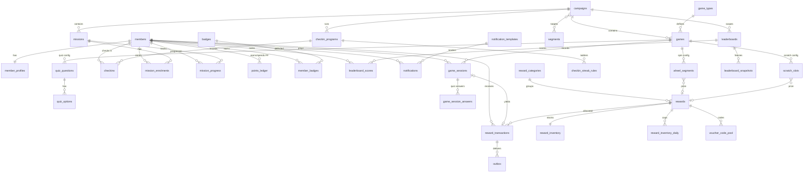
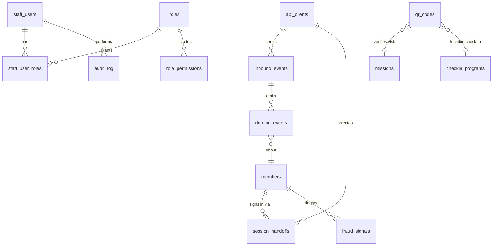

# 5. Database Design & ER Diagram

PostgreSQL, 3NF for transactional data. Ledgers are append-only. Configuration that varies by game type is stored as validated `jsonb` (validated by Zod in the API and by CHECK constraints in SQL). Every table has **Row Level Security**. Every value-moving table has a **unique idempotency constraint**.

## 5.1 Brief entity → table mapping

| Brief entity (§9) | Table(s) |
|---|---|
| Customer | `members` (only the reference to the Suntec+/Capillary member, with minimal personal data) |
| CustomerGamificationProfile | `member_profiles` (PP balance, streaks, privacy, counters) |
| Campaign | `campaigns`, `campaign_segments` |
| Game | `games`, `game_types`, `wheel_segments`, `scratch_slots`, `quiz_questions`, `quiz_options` |
| GameSession | `game_sessions`, `game_session_answers` |
| Mission | `missions` |
| MissionParticipation | `mission_enrolments` |
| MissionProgress | `mission_progress` (per period), `mission_progress_events` (dedupe) |
| CheckInHistory | `checkins`, `checkin_programs`, `checkin_streak_rules` |
| Reward | `reward_categories`, `rewards` |
| RewardInventory | `reward_inventory`, `reward_inventory_daily`, `voucher_code_pool` |
| RewardTransaction | `reward_transactions`, `outbox` |
| *(Play Points)* | `points_ledger` (separate from Capillary points) |
| Badge / CustomerBadge | `badges`, `member_badges` |
| Leaderboard | `leaderboards`, `leaderboard_scores`, `leaderboard_snapshots` |
| Notification | `notification_templates`, `notifications`, `notification_dispatches` |
| AdminUser / UserRole | `staff_users`, `roles`, `role_permissions`, `staff_user_roles` |
| AuditLog | `audit_log` |
| *(Supporting)* | `segments`, `eligibility_rules`, `inbound_events`, `domain_events`, `idempotency_keys`, `rate_limits`, `api_clients`, `session_handoffs`, `qr_codes`, `fraud_signals`, `app_settings`, `analytics_daily` |

## 5.2 ER diagram: engagement core

## 5.3 ER diagram: platform, security and integration

## 5.4 Key tables (abridged data dictionary)

| Table | Key columns | Integrity and indexes |
|---|---|---|
| `members` | id (uuid), suntec_member_id, card_no, auth_user_id, display_name, email, tier, joined_at, status | UNIQUE(suntec_member_id), UNIQUE(card_no), UNIQUE(auth_user_id), idx(status) |
| `member_profiles` | member_id PK, pp_balance, pp_lifetime, current_streak, best_streak, last_checkin_day, lb_display_mode, lb_opt_out, version | `pp_balance >= 0` CHECK. The row is locked `FOR UPDATE` on every balance change. |
| `campaigns` | id, name, slug, status, priority, starts_at, ends_at, banner_path, limits jsonb, eligibility_rule_id | idx(status, starts_at, ends_at), CHECK(ends_at > starts_at) |
| `games` | id, campaign_id, type, name, status, config jsonb, attempt_rules jsonb (free_per_day, pp_cost, cooldown_s, max_per_campaign), starts_at, ends_at | idx(campaign_id, status) |
| `wheel_segments` | game_id, position, label, color, icon, reward_id, weight_bp (0–10000), fallback_strategy, fallback_segment_id | UNIQUE(game_id, position). Publish check: Σweight_bp = 10000. |
| `game_sessions` | id (`GS-…`), member_id, game_id, status, payment_source, pp_cost, outcome jsonb, score, reward_txn_id, idempotency_key, device_hash, ip_hash, started_at, expires_at, completed_at | **UNIQUE(member_id, idempotency_key)**, idx(member_id, game_id, started_at DESC), idx(game_id, started_at) |
| `checkins` | member_id, program_id, day (date, SGT), streak_after, source (app, qr) | **UNIQUE(member_id, program_id, day)**, idx(day) |
| `missions` | id, campaign_id, title, category, objective jsonb {type, target, filters}, recurrence (once, daily, weekly, monthly), enrolment (auto, opt_in), max_participants, reward_spec jsonb, starts_at, ends_at | idx(campaign_id, status) |
| `mission_progress` | mission_id, member_id, period_key, progress numeric, target, completed_at, reward_txn_id | **UNIQUE(mission_id, member_id, period_key)**, so a mission can't be completed twice in the same period |
| `mission_progress_events` | mission_id, member_id, source_event_id | UNIQUE(mission_id, source_event_id), so the same event is never counted twice |
| `points_ledger` | id, member_id, delta, balance_after, reason, ref_type, ref_id, expires_at, idempotency_key | UNIQUE(member_id, idempotency_key), idx(member_id, created_at DESC). Append-only (UPDATE and DELETE revoked). |
| `rewards` | id, category_id, type, name, value jsonb (points, voucher series, code pool), pp_cost, eligibility_rule_id, validity_days, per_member_cap, status | idx(category_id, status) |
| `reward_inventory` | reward_id PK, total_qty, remaining_qty, low_stock_threshold | CHECK(remaining_qty >= 0). Decremented under `FOR UPDATE`. |
| `reward_transactions` | id (`RT-…`), member_id, reward_id, source (game, mission, checkin, badge, redeem, admin), source_ref, status, external_ref, voucher_code (encrypted), attempts, last_error, issued_at, redeemed_at, expires_at, idempotency_key | UNIQUE(source, source_ref, reward_id), UNIQUE(member_id, idempotency_key), idx(status, updated_at), idx(member_id, created_at DESC) |
| `outbox` | id, kind (capillary.award, vms.issue, push.send…), payload, status, attempts, next_attempt_at, last_error | idx(status, next_attempt_at), partial index WHERE status IN ('pending', 'retry') |
| `leaderboard_scores` | board_id, period_key (`2026-11-27`, `2026-W48`, `2026-11`, `all`), member_id, score, reached_at | PK(board_id, period_key, member_id), idx(board_id, period_key, score DESC, reached_at) |
| `member_badges` | member_id, badge_id, awarded_at, source_event | PK(member_id, badge_id) |
| `notifications` | id, member_id, template_key, title, body, deep_link, read_at, created_at | idx(member_id, created_at DESC), partial idx WHERE read_at IS NULL |
| `inbound_events` | id, client_id, type, external_id, member_id, payload, occurred_at, processed_at, status | **UNIQUE(client_id, external_id)** |
| `idempotency_keys` | scope, key, request_hash, status, response, created_at | PK(scope, key). Purged after 24–72 h. |
| `audit_log` | id, actor_type, actor_id, role, action, entity, entity_id, before, after, ip_hash, request_id, created_at | Append-only. idx(entity, entity_id), idx(actor_id, created_at) |
| `analytics_daily` | day, campaign_id, game_id, metric, value | PK(day, campaign_id, game_id, metric) |

## 5.5 Data design rules
- **Two point systems kept apart:** Play Points live only in `points_ledger` and `member_profiles.pp_balance`. Capillary loyalty points are never stored. They are only *requested* through `reward_transactions` and the outbox, and the Capillary transaction ID is kept as `external_ref`.
- **History is immutable:** ledger, sessions, transactions and audit rows are never updated after they are final. Corrections are written as new reversing entries.
- **Partitioning readiness:** `game_sessions`, `points_ledger`, `domain_events` and `audit_log` are designed for monthly range partitioning on `created_at` once their volume needs it (for example more than 50M rows).
- **Mock schema:** `mock_capillary` (members, points, coupons) mirrors the adapter contract for DEV and SIT, and isn't deployed to PROD.
