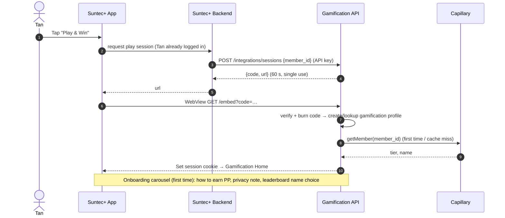
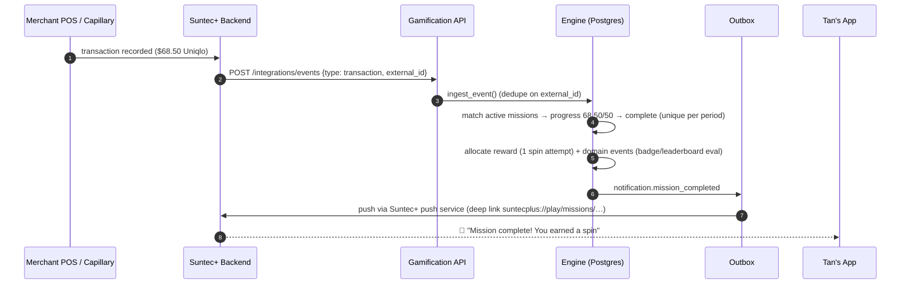

# 9. End-to-End Customer Journeys

## 9.1 Journey map: "Tan's Saturday at Suntec City"

```mermaid
journey
  title Tan's engagement loop
  section Morning (home)
    Push "Your streak is at 6 days!": 4: Tan
    Open Suntec+ → Play & Win: 5: Tan
    Daily check-in → +10 PP, day 7 bonus spin: 5: Tan
  section At the mall
    Scan concierge QR → mission "Visit 3×" 3/3 ✔: 5: Tan
    Buy at Uniqlo $68.50 → mission "Spend $50" ✔ → +1 spin: 5: Tan
    Spin & Win → $5 Dining Voucher: 5: Tan
    Use voucher at food court (VMS redemption): 4: Tan
  section Evening
    Suntec Trivia quiz → 850 pts, rank #42: 4: Tan
    Badge "Shopping Explorer" unlocked: 5: Tan
    Redeem 1,000 PP → 500 Suntec+ points (Capillary): 5: Tan
```

## 9.2 First-time entry (in-app SSO)


## 9.3 Mission → reward → Capillary


## 9.4 Redeem PP for Suntec+ loyalty points
1. Tan opens **Rewards → Catalogue** and picks "500 Suntec+ Points" (1,000 PP).
2. `POST /rewards/{id}/redeem` with an Idempotency-Key. In one transaction, the engine checks eligibility and stock, locks the PP balance, debits 1,000 PP to the ledger, creates reward transaction `RT-…` (pending) and adds an `outbox` entry for `capillary.award`.
3. The outbox worker calls Capillary with **idempotency key = RT id**. On success it marks the transaction **issued**, stores the `external_ref` and notifies Tan.
4. If Capillary fails, the worker retries with backoff. After 10 failures the transaction becomes **failed** and appears in Admin → Failed transactions. An admin can retry it, or cancel it, which **refunds the PP automatically** with a reversing ledger entry.

## 9.5 Unhappy paths (designed explicitly)

| Situation | Behaviour |
|---|---|
| Double-tap on Spin / network retry | The same Idempotency-Key returns the same session, so there's exactly one play |
| Prize out of stock at spin time | Fallback segment, or renormalise to in-stock segments. The customer never sees "error". |
| Quiz answers submitted after the time limit | `410 SESSION_EXPIRED`. Answers given after a question's limit score 0. |
| Second check-in the same day | `409 ALREADY_CHECKED_IN`, and the UI shows "See you tomorrow" with a countdown |
| Capillary down | Games keep working. Rewards are queued as pending and the UI shows "Processing". |
| Suspicious velocity (bot) | Rate limited (429), and a fraud signal is raised. Repeat offenders are auto-flagged and the wins are held for review. |
| Gamification platform down | The app's "Play & Win" screen shows a friendly maintenance page. Everything else in Suntec+ is unaffected. |
