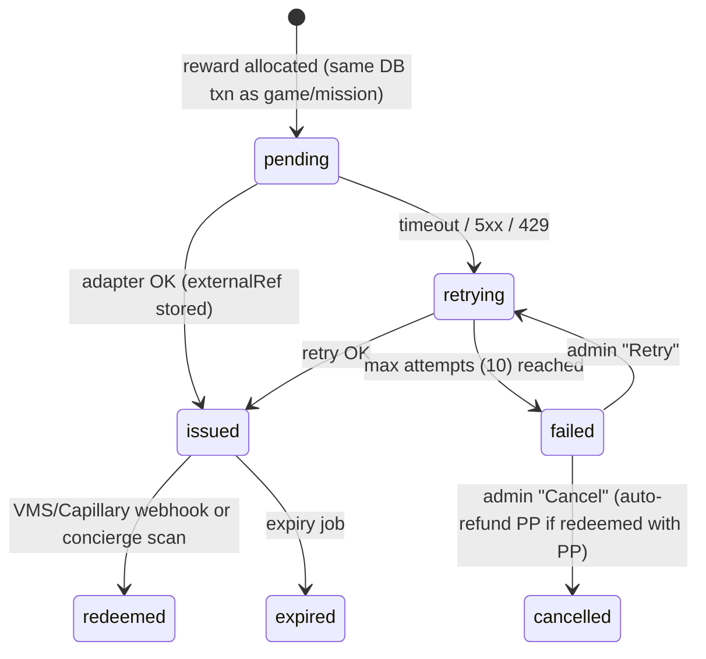

# 10. Integration Flow: Suntec+ App, Suntec+ Backend and Capillary

> **Important:** the exact Capillary endpoints, authentication method (OAuth client credentials or API key) and rate limits must be confirmed with Suntec+ IT and Capillary in M0. The platform calls Capillary **only through adapter interfaces**, so contract changes touch one file, not the engine.

## 10.1 Integration touchpoints

| # | From → To | Mechanism | Purpose | Failure handling |
|---|---|---|---|---|
| I-1 | Suntec+ App → Gamification UI | WebView + `/embed?code=` | Open the "Play & Win" module | Friendly error page, `bridge.close()` |
| I-2 | Suntec+ Backend → Gamification API | `POST /integrations/sessions` (API key, HMAC) | SSO handoff for a logged-in member | App shows a retry. The code expires in 60 s. |
| I-3 | Gamification → Capillary | LoyaltyAdapter (HTTPS, OAuth/API key) | Member lookup, tier, award and deduct loyalty points | Cached member data. Awards go through the outbox and retries. |
| I-4 | Gamification → Voucher Mgmt (VMS / Capillary coupons) | VoucherAdapter | Issue a voucher from a series, read its status | Pre-issued code pool as an optional buffer. Outbox and retries. |
| I-5 | Capillary / POS / Suntec+ Backend → Gamification | `POST /integrations/events` | Transactions, visits, voucher redemptions, campaign participation for missions | Deduplicated by `external_id`. The sender retries on 5xx. |
| I-6 | VMS / Capillary → Gamification | Webhooks (signed) | Voucher redeemed or expired, points reversal, tier change | Accepted idempotently, with a reconciliation job each night |
| I-7 | Gamification → Suntec+ Push service | PushAdapter | Notifications with deep links | Outbox and retries. The in-app inbox is always written. |
| I-8 | Suntec+ App ↔ Gamification UI | JS bridge (`postMessage`) | Haptics, close, share, open native screen, analytics events | No-op if the bridge is absent (for example in the web portal) |
| I-9 | BI (Power BI) → Gamification DB | Read-only `reporting` role / report API | Dashboards | Read replica (PROD), if load requires it |

## 10.2 Adapter contracts (TypeScript, `packages/core`)

```ts
interface LoyaltyAdapter {                     // Capillary
  lookupMember(q: { memberId?: string; cardNo?: string; email?: string; mobile?: string }): Promise<LoyaltyMember | null>;
  getMember(memberId: string): Promise<LoyaltyMember>;        // tier, name, status
  getPointsBalance(memberId: string): Promise<number>;        // display only — never cached as truth
  awardPoints(req: { memberId: string; points: number; reason: string; idempotencyKey: string }): Promise<{ externalRef: string }>;
  deductPoints(req: { memberId: string; points: number; reason: string; idempotencyKey: string }): Promise<{ externalRef: string }>;
  reverse(req: { externalRef: string; idempotencyKey: string }): Promise<void>;
}
interface VoucherAdapter {                     // VMS or Capillary coupons
  issueVoucher(req: { memberId: string; seriesId: string; idempotencyKey: string }): Promise<{ code: string; externalRef: string; expiresAt?: string }>;
  getVoucherStatus(externalRef: string): Promise<'issued' | 'redeemed' | 'expired' | 'cancelled'>;
  cancelVoucher(externalRef: string): Promise<void>;
}
interface PushAdapter {                        // Suntec+ push infrastructure
  send(req: { memberId: string; title: string; body: string; deepLink?: string; idempotencyKey: string }): Promise<void>;
}
```
`LOYALTY_ADAPTER=mock|capillary` (and the equivalents for voucher and push) chooses the implementation for each environment. The **mock** implementation uses the `mock_capillary` schema, so the full end-to-end flow works in DEV and SIT before Capillary access is granted.

## 10.3 Reward delivery (outbox pattern)



- **Idempotency end to end:** the `reward_transactions.id` is passed as the idempotency key (or Capillary's dedupe or transaction-number field) on every call, so retries can never award twice.
- **Never a duplicate balance:** Capillary points are *requested*, never stored as a balance on our side. `getPointsBalance` is only used to display the current figure.
- **Nightly reconciliation:** a job compares issued transactions with the Capillary and VMS reports and flags any mismatch in the Failed Transactions report.

## 10.4 Mobile app integration kit (deliverable #10)
Delivered in `integrations/mobile/` in M4:

| Platform | Contents |
|---|---|
| iOS (Swift) | `PlayAndWinViewController` (WKWebView with `WKScriptMessageHandler` bridge, cookie and data-store setup, deep-link router, pull-to-close) |
| Android (Kotlin) | `PlayAndWinActivity` (WebView with `JavascriptInterface` bridge, `CookieManager`, safe-browsing on, `file://` access disabled, deep links) |
| React Native | `<PlayAndWin />` component (`react-native-webview`, `onMessage` bridge) |
| Flutter | `PlayAndWinPage` (`webview_flutter`, `JavaScriptChannel` bridge) |
| Backend snippet | Node, Java and .NET examples for calling `POST /integrations/sessions` from the Suntec+ backend |

**Bridge events (web → native):** `ready`, `close`, `haptic {style}`, `share {url,text}`, `open_native {screen}`, `analytics {name, props}`, `reward_won {txn_id}`.
**Deep links (native → web):** `suntecplus://play`, `suntecplus://play/{checkin|missions|spin|scratch|quiz|leaderboard|badges|rewards|history}`, plus `.../rewards/{txnId}` and `.../missions/{id}`.
**Performance safeguards:** lazy WebView creation (only when the user opens the module), no preloading on app start, a static asset CDN with long cache lifetimes, and a JS bundle budget of 150 KB gzipped for the embed routes.
