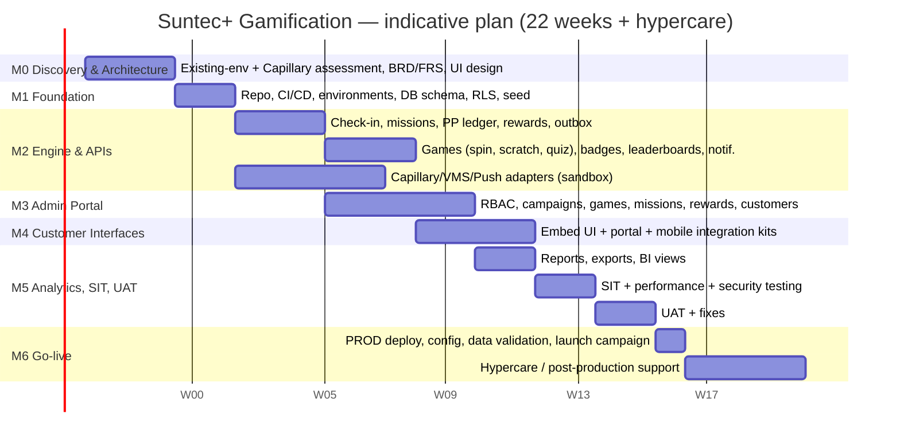

# 11. Development Timeline & Milestones

This is an indicative plan. Week 1 is the week the solution pack is approved. Milestones follow the SDLC in brief §14.

| Milestone | Weeks | Exit criteria and deliverables |
|---|---|---|
| **M0** Discovery and architecture | 1–3 | Answers to the environment checklist ([03](03-tech-stack.md#34-existing-environment-assessment-checklist-m0-with-suntec-it)). Capillary sandbox access. Signed-off BRD and FRS. UI designs in Figma. Final NFR targets. |
| **M1** Foundation | 4–5 | Monorepo, CI/CD, DEV/SIT/UAT/PROD projects, full schema and RLS, seed data, `setup_all.sql` |
| **M2** Engine and APIs | 6–11 | All engine modules, Customer, Game, Mission, Check-in, Reward, Leaderboard and Integration APIs, OpenAPI spec, unit and SQL integration tests, adapters against the Capillary sandbox |
| **M3** Admin portal | 9–13 | Every configuration screen, simulator, customer 360, failed transactions, users and roles, audit log |
| **M4** Customer interfaces | 12–15 | Embed UI (all 10 sections), web portal, iOS, Android, RN and Flutter kits, integration guide |
| **M5** Analytics and testing | 14–19 | 10 reports, CSV and Excel, BI views. SIT test cases and report. Performance test (k6) and security test (ZAP plus third-party penetration test). UAT sign-off. |
| **M6** Go-live | 20–22 (+4 weeks hypercare) | PROD deployment, launch campaign configured, monitoring and alerts live, runbook, admin manual, handover |

## 11.1 Build phases in this repository
Each phase ends with a commit and push to `main`, a summary, and any actions needed from you (for example running SQL).

| Phase | Scope | Maps to |
|---|---|---|
| 1 | Foundation and database: scaffold, tokens, all migrations (RLS, indexes, functions), `setup_all.sql`, `seed.sql` | M1 |
| 2 | Engine and APIs: RPCs for check-in, missions, games, rewards, PP, badges, leaderboards, notifications, event ingest. Adapters (mock plus Capillary skeleton). API routes and OpenAPI. Unit tests. | M2 |
| 3 | Admin control panel | M3 |
| 4 | Customer portal, embed UI and mobile integration kits | M4 |
| 5 | Analytics, reports and exports | M5 (part) |
| 6 | Integration and concurrency tests, SIT and UAT test-case catalogue, README, API.md, INTEGRATION.md, SETUP.md, admin manual, support runbook | M5–M6 documentation |
